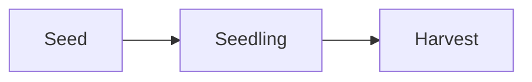

# Your first site, doc and deck

A walk from an empty folder to a small site, a doc and a deck that update
while you edit them. It is the tutorial under
[Getting started](getting-started.md); you need devpage
[installed](installing.md).

## A site

Make a folder `garden/` with three files:

<FileTree>

- garden/
  - devpage.yml — the site: its title and root page
  - README.md — the root page, whose Topics list the sidebar
  - planting.md — a page with a diagram

</FileTree>

<Tabs>
<Tab title="devpage.yml">

```yaml
kind: site
title: Garden
root: README.md
```

</Tab>
<Tab title="README.md">

```markdown
# Garden

Notes on the vegetable garden.

## Topics

- [Planting](planting.md) — what goes in the ground, and when.
```

</Tab>
<Tab title="planting.md">

````markdown
# Planting


````

</Tab>
</Tabs>

<Steps>

1. Run it
   From the folder holding `garden/`. Given a folder, devpage reads the
   `devpage.yml` inside it, prints the address it serves on — or the next port
   up when 3030 is taken — and then logs each request it answers.

   $ devpage garden

2. Open the address
   `/` leads to the root page. The sidebar shows the site's title, *Garden*,
   and under it one entry, *Planting* — the label is the link's text in the
   Topics list, not the page's heading.

3. Follow the link
   Clicking *Planting* swaps the page in place, and the address becomes the
   file's path. The sidebar highlights *Planting*, and the Mermaid fence is
   drawn as a three-box diagram.

4. Edit a file
   With the page open, add a line to `planting.md` and save: the page updates
   within moments, without a reload. Add a Topics item in `README.md` pointing
   at `watering.md` before the file exists: the link is marked broken and
   listed at the top of the page until you create the file — then the sidebar
   grows a *Watering* entry on every open page.

5. Comment
   Turn on comment mode with the speech-bubble button in the top-right corner,
   select a few words on *Planting* and comment on them. The comment is in the
   margin, and in `.devpage/comments/` as a small YAML file; press **Resolve**
   and the file is gone.

</Steps>

## A doc

Add `garden/plan/devpage.yml`, with the two chapters beside it, each starting
with a `# heading`:

<FileTree>

- garden/plan/
  - devpage.yml — the doc: its title and chapters in order
  - beds.md — chapter 1
  - schedule.md — chapter 2

</FileTree>

```yaml
kind: doc
title: Spring plan
chapters: [beds.md, schedule.md]
```

Link to it from `README.md` as `[Spring plan](plan/devpage.yml)`. It opens as
one long page with an outline beside it, and prints to PDF:

<Terminal>

```
$ devpage pdf garden/plan
Spring plan.pdf
```

</Terminal>

## A deck

Add `garden/talk/devpage.yml` with `kind: slides`, a `title`, and `slides:`
listing one Markdown file per slide, and link to it from `README.md` as
`[Spring talk](talk/devpage.yml)`. Open it, use the arrow keys
<Keys>← →</Keys>, press <Keys>F</Keys> for fullscreen; `devpage pdf
garden/talk` prints one slide per page.

## Check it

`devpage check garden` checks the site and everything it links to — here, all
three — and exits `1` if a link is broken: ready for a test.

For a finished example of each kind: these docs are a site,
[the feature catalog](features/devpage.yml) is a doc,
[the devpage talk](talks/devpage/devpage.yml) is a deck, and
[the checkout prototype](designs/checkout/checkout.design) is a design — all
four in the navbar's **Examples** menu.
